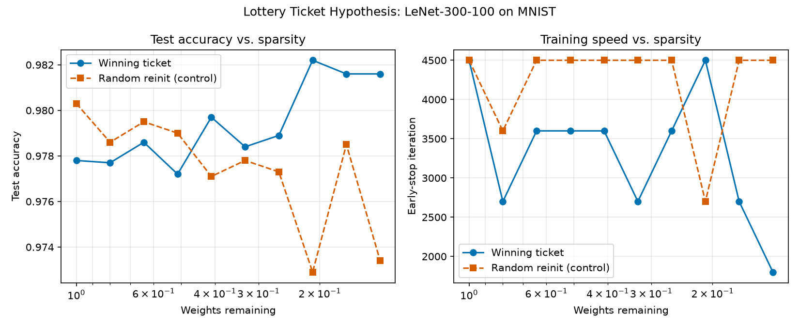

# The Lottery Ticket Hypothesis

PyTorch reproduction of Frankle & Carbin's ["The Lottery Ticket Hypothesis: Finding Sparse, Trainable Neural Networks"](https://arxiv.org/abs/1803.03635) (ICLR 2019). Implements iterative magnitude pruning (IMP) plus the random-reinitialization control the paper uses to test the hypothesis, not just the pruning algorithm on its own.

## Why the control matters

It's not hard to show that a pruned network can still hit decent accuracy, that part isn't really in question. What the paper argues is more specific: a sparse subnetwork trains well *because of the particular initial weights it started with*, not just because of which connections survived. Pull the same mask out but start it from a different random init, and it should train noticeably worse.

So the experiment here runs two things side by side at every sparsity level:

1. **Winning ticket** - after each pruning round, the surviving weights get reset back to their original initialization `θ₀`. This is the standard IMP procedure.
2. **Random reinit (control)** - the exact same mask, but applied to a network with a brand new random initialization.

If the winning ticket noticeably outperforms the control at the same sparsity, that's evidence for the hypothesis. If they're about the same, pruning alone explains the result and the "winning ticket" framing isn't adding anything.

### Iterative magnitude pruning, step by step

1. Randomly initialize a network `f(x; θ₀)`.
2. Train it for `j` iterations, getting trained weights `θⱼ`.
3. Prune the `p`% of weights with the smallest magnitude. This gives a binary mask `m`.
4. Reset the surviving weights to their *original* values from `θ₀`, not the trained ones. That's the winning ticket: `f(x; m ⊙ θ₀)`.
5. Repeat from step 2, pruning `p`% of whatever's left each round, until you hit the target sparsity.

## Project structure

```
.
├── src/
│   ├── main.py             # CLI entry point - runs IMP + the reinit control, saves results/plots
│   ├── models/lenet.py      # LeNet-300-100 (the paper's MNIST model) + a configurable ConvNet
│   ├── pruning/imp.py       # LotteryTicketPruner - masking, pruning, resetting, reinit-control support
│   ├── datasets/loaders.py  # MNIST / CIFAR-10 loaders with seeded train/val splits
│   └── utils/
│       ├── trainer.py       # Training/eval loop, freezes pruned weights via gradient masking
│       └── seed.py          # Seeds python/numpy/torch for reproducible runs
├── tests/                   # pytest unit tests for the pruning and training logic
├── experiments/
│   ├── runs/results.json    # Per-round metrics, winning ticket and control
│   └── plots/                # Generated comparison plots
└── requirements.txt
```

## Setup

```bash
pip install -r requirements.txt
```

## Running an experiment

```bash
cd src
python main.py
```

Full flag list is in `python main.py --help`, but the ones you'll actually touch:

| Flag | Default | What it does |
|---|---|---|
| `--rounds` | 10 | Number of pruning rounds |
| `--epochs` | 5 | Training epochs per round |
| `--lr` | 1.2e-3 | Adam learning rate |
| `--pruning-rate-fc` | 0.2 | Fraction of remaining FC weights pruned per round |
| `--seed` | 42 | Seed for reproducibility (init, data split, shuffling) |
| `--no-control` | off | Skip the random-reinit control (faster, but you lose the actual comparison) |
| `--quiet` | off | Turn off the per-batch progress bars |

Each run writes `experiments/runs/results.json` (per-round metrics for both runs, plus the config that produced them) and `experiments/plots/lottery_ticket_results.png`.

## Results

LeNet-300-100 on MNIST. 10 rounds, 20% of remaining FC weights pruned per round, 5 epochs/round, Adam at `lr=1.2e-3`, seed 42.



| Round | Weights remaining | Winning ticket acc. | WT early-stop iter | Control acc. | Control early-stop iter |
|---|---|---|---|---|---|
| 0 | 100.00% | 0.9778 | 4500 | 0.9803 | 4500 |
| 1 | 80.00%  | 0.9777 | 2700 | 0.9786 | 3600 |
| 2 | 64.00%  | 0.9786 | 3600 | 0.9795 | 4500 |
| 3 | 51.20%  | 0.9772 | 3600 | 0.9790 | 4500 |
| 4 | 40.96%  | 0.9797 | 3600 | 0.9771 | 4500 |
| 5 | 32.77%  | 0.9784 | 2700 | 0.9778 | 4500 |
| 6 | 26.21%  | 0.9789 | 3600 | 0.9773 | 4500 |
| 7 | 20.97%  | 0.9822 | 4500 | 0.9729 | 2700 |
| 8 | 16.77%  | 0.9816 | 2700 | 0.9785 | 4500 |
| 9 | 13.42%  | 0.9816 | 1800 | 0.9734 | 4500 |

Single seed (`seed=42`), see limitations below.

Up through round 6 (26% of the weights left), the winning ticket and the control are basically tied, both sit in the 0.977-0.980 range. That tracks: pruning away less than 75% of a network this overparameterized doesn't remove much that mattered in the first place, so the initialization isn't doing much work yet.

Rounds 7-9 (21% of the weights or less) is where it splits. The winning ticket hits its best accuracy of the whole run at round 7 (0.9822) and its early-stop iteration drops as low as 1800, so it's both more accurate and converging faster. The control falls to its worst accuracy (0.9729) and in two of those three rounds never improves its validation loss past the 4500-iteration budget ceiling, meaning it's still struggling to fit the data by the time training cuts off. Same sparse mask, different starting weights, different outcome - that's the actual thing the paper is claiming.

## Testing

```bash
pip install pytest
pytest tests/ -v
```

Covers mask initialization, that `prune_step` removes the right fraction and specifically the smallest-magnitude weights, that `reset_weights` restores `θ₀` correctly under the mask, that building the control model doesn't touch the winning ticket's weights, that pruned weights stay frozen at zero during training, and that training actually brings the loss down.

## Known limitations / future work

- Only LeNet-300-100 on MNIST runs end to end. There's a `ConvNet` class and CIFAR-10 loaders already in the repo, just not wired into an experiment yet (Conv-2/4/6 from the paper).
- Pruning is layer-wise, not global - the paper notes global pruning matters more once you go to deeper networks.
- No learning-rate warmup, which the paper needed to find winning tickets in deeper networks at higher learning rates.
- Single-seed runs. The paper averages over several random seeds per sparsity level and reports error bars; this repo currently doesn't.
